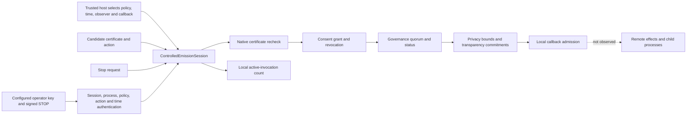

# Cooperative corrigibility control in the 2.0.0 candidate

Verifier Standard (VSTD) is the evidence standard; Verifier is its reference
implementation. This experimental direct submodule establishes one bounded
in-process proposition: a cooperating host invokes a local callback only after
the existing certificate admission returns `PASS`, and a latched stop refuses
later callback admissions in the same session. No physical unit attaches to a
verdict or invocation identifier. Timeouts are measured in seconds.

`ControlledEmissionSession.invoke` calls `evaluate_controlled_emission` for
every attempt. A rejected or unknown admission never reaches the callback.
A successful invocation identifier is spent within that session before the
callback is called; a callback failure does not make it reusable because the
external side effect might have begun. This is local replay prevention, not
durable or distributed single-use enforcement. The local inventory has a
fixed 4,096-identifier bound; exhaustion refuses new effects rather than
silently dropping old identifiers. This is a finite memory safety bound, not
a measured throughput optimum. The callback receives the
admitted certificate, not the private consent and governance receipt. The
caller must disclosure-review that receipt before sharing it.

`request_stop` latches permanently. If any invocation is active, it returns
`STOP_REQUESTED`; only a zero active count yields `QUIESCENT`.
`wait_for_quiescence` returns true only after stop has been requested and every
locally tracked invocation has returned. A callback admitted just before the
stop may continue; a timeout returns false. The host must ensure every relevant
effect uses this gate. Another process, a spawned child, network operation,
durable queue or physical actuator is outside this observation boundary.

An already admitted callback can observe `stop_requested` or block with
`wait_for_stop(timeout_seconds)` to exit cooperatively. The latter waits on a
monotonic deadline measured in seconds and returns false on timeout. In a
protected session, forged or otherwise refused STOP requests do not wake it as
a successful stop; only a latched, authenticated request does. This supplies a
callback-visible signal, not preemption: the callback must check or wait, and
work it performs before observing the latch may already have effects.

An opt-in `OperatorStopPolicy` in `verifier.corrigibility.operator_stop` binds
`ControlledEmissionSession(stop_authority=policy)` to configured public keys.
The host selects and protects this policy; candidate evidence cannot select its
own operator. A stop request contains an exact body with policy digest, random
session identifier, current process identifier, `STOP` action, configured
operator and key identifiers, request identifier, and issue/expiry times. The
body is signed under the domain-separated Ed25519 (Edwards-curve digital
signature algorithm with a 255-bit field) message returned by
`stop_signing_bytes`; times and policy age limits are integer Coordinated
Universal Time Unix seconds. The module first captures the exact plain outer
envelope, then captures its plain body once before checking bindings and
signature. A caller changing its original mappings cannot introduce a foreign
copy hook or transfer a signature to another session. A missing, forged, substituted,
stale, future or unsupported request does not latch the stop. A valid request
returns `authorization: PASS`, a digest of the captured signed request and the
actual local `stop_latched` state. If the signature backend is unavailable,
authorization is `UNKNOWN` and the stop is not acknowledged. A session without
`stop_authority` retains the earlier cooperative `request_stop()` path and
reports `authorization: NOT_REQUIRED`; it is not authenticated control.

The signature establishes only use of a configured key over those exact bytes.
It does not identify the key holder as a human, establish that holder's real
authority, attest key custody, make the host clock trustworthy, authenticate
every possible control entry point, preempt an already admitted callback, or
consume a stop durably across crashes. The signed request is checked before
the local stop latch is acknowledged, so effects admitted during authentication
can remain active and are reported as such. The host must not expose this Python
session or its private state to untrusted same-process code: Python attribute
access is not an isolation boundary. Public session and process coordinates are
read-only properties to prevent accidental reassignment, not hostile reflection.

The host must establish and protect the authority source for consent policy,
revocation view, governance policy and status, evaluation time, observer facts
and stop requests. Python object possession is not operator authentication;
the opt-in signed path only authenticates the configured public-key statement.
The admission evaluator checks configured statements; it cannot establish
holder-set completeness, a person's actual consent or legal authority.
Nor does a local callback return prove remote publication or complete effect.

The following remain open before any stronger corrigibility claim: authenticate
the operator and holder authority; ensure fresh revocation at the actual effect
boundary; make invocation consumption durable and atomic with the effect; track
children and delayed work after stop; demonstrate bounded interruption or
quiescence under adversarial and crash conditions; and bind those observations
to an independently replayable VSTD certificate. None is supplied by a
declared shutdown-indifference or hardware-attestation record.
